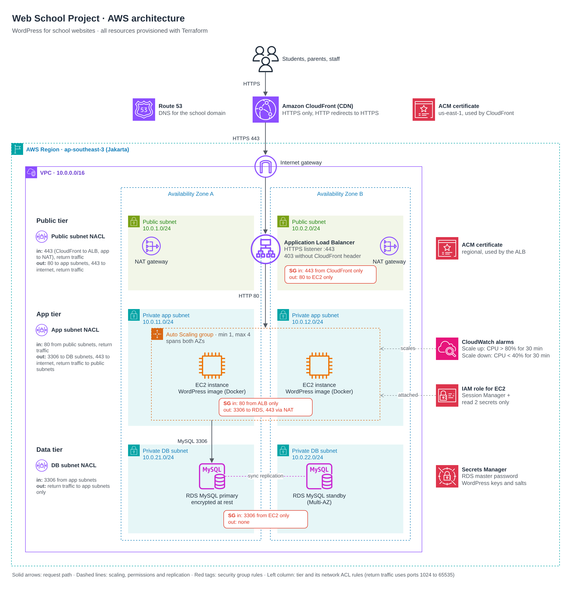

# Web School: WordPress on AWS with Terraform

Terraform for a platform that hosts school websites: WordPress on Amazon EC2 behind an Application Load Balancer (ALB) and Amazon CloudFront, with its data in Amazon RDS for MySQL. The stack runs in the Asia Pacific (Jakarta) Region, ap-southeast-3. CloudFront and Route 53 are global, and CloudFront's certificate is in us-east-1, the only Region CloudFront takes certificates from.



Visitors reach the site over HTTPS through CloudFront, which caches WordPress's static files at the edge and sends www visitors to the apex. CloudFront connects to the ALB over HTTPS and adds a secret header; the ALB forwards only requests that carry it, over HTTP inside the VPC, to the WordPress instances in private subnets. WordPress keeps its data in a Multi-AZ RDS for MySQL database, in subnets with no route to the internet, and connects to it over TLS. The instances run the official WordPress Docker image in an Auto Scaling group of 1 to 4 instances, which adds an instance when their average CPU stays above 80% for 30 minutes and removes one when it stays below 40% for 30 minutes.

The stack has not been deployed. It is tested with 131 plan-time tests, a plan against a real AWS account with read-only credentials, a Node test of the CloudFront Function and a local Docker test of the instances' startup script. [docs/report.md](docs/report.md) covers the design, the security measures, the test plan and results, and the trade-offs and next steps; [docs/evidence/](docs/evidence/) holds the output of every check.

## Project requirements

- Terraform for every resource: repeatable and version-controlled.
- Amazon CloudFront as the CDN for public connections.
- An ALB that spreads traffic across multiple EC2 instances for high availability.
- EC2 instances that run the WordPress image in an Auto Scaling group: 1 to 4 instances, scaling up when CPU is above 80% for 30 minutes and down when it is below 40% for 30 minutes.
- Amazon RDS for MySQL that stores the website data securely.
- Security: HTTPS on CloudFront and the ALB, security groups and network ACLs that restrict traffic to and from the instances and the database, and IAM roles with the minimum permissions.

Section 8 of [docs/report.md](docs/report.md) traces each one to its resources and tests.

## Repository layout

```text
.
├── versions.tf  providers.tf  backend.tf
├── main.tf  variables.tf  outputs.tf  terraform.tfvars
├── modules/
│   ├── network/    VPC, public, app and DB subnets in two AZs, internet and NAT gateways, route tables
│   ├── security/   security groups and network ACLs
│   ├── dns/        Route 53 hosted zone, both ACM certificates and their DNS validation
│   ├── database/   RDS for MySQL, its parameter group, error log group and password rotation schedule
│   ├── alb/        ALB, HTTPS listener and origin secret rule, target group, origin record
│   ├── compute/    instance role, WordPress keys secret, launch template, Auto Scaling group, CPU alarms
│   └── cdn/        CloudFront distribution, static files cache policy, www redirect, apex and www records
├── tests/          plan-time tests, the CloudFront Function test and the local Docker test
└── docs/           design and test report, system diagram and evidence
```

`main.tf` calls the seven modules and passes each module's outputs to the inputs of the same name. `terraform.tfvars` sets every root input; none of them is secret. Each module's README describes what it builds and why, with its inputs and outputs.

## Prerequisites

- Terraform 1.11 or newer. `.terraform.lock.hcl` pins the providers: hashicorp/aws 6.70.0 and hashicorp/random 3.9.1.
- For `terraform plan`, AWS credentials that can read the account. Read-only access is enough: the plan only looks up data that AWS manages, such as the CloudFront prefix list and managed policies, the Session Manager IAM policy and the latest Amazon Linux 2023 AMI.
- Optional: Node.js 21 or newer for the CloudFront Function test; bash, curl and Docker Engine 26 or newer for the local Docker test; TFLint and checkov for the static checks.

## Check and plan

From the repository root:

```bash
terraform init
terraform fmt -check -recursive
terraform validate
terraform test
node --test "tests/functions/*.test.cjs"
terraform plan
```

- `terraform test` plans each module, and the root with `terraform.tfvars`, against a mock AWS provider, so it needs no AWS credentials and creates nothing.
- `node --test` renders the cdn module's CloudFront Function with `terraform console` and runs it against sample requests. It needs `terraform` on the PATH, or `TERRAFORM` set to its path.
- `bash tests/integration/run.sh` runs the pieces of the compute module's user_data with Docker, without AWS. [tests/integration/README.md](tests/integration/README.md) lists what it proves and what it does not.
- TFLint: `tflint --init`, then `tflint --recursive --config "$(pwd)/.tflint.hcl"`. checkov: `checkov -d . --framework terraform`.

## Deploy

1. Set `domain_name` in `terraform.tfvars` to the school's domain; `webschool.example` is a placeholder.
2. Create the hosted zone on its own: `terraform apply -target=module.dns.aws_route53_zone.this`.
3. At the domain's registrar, set the name servers to the ones `terraform output name_servers` prints. ACM validates the certificates through this zone, so the domain must point at it first.
4. Run `terraform apply`.

Deletion protection stops `terraform destroy` from deleting the ALB and the database. For a throwaway deploy, set `alb_deletion_protection` and `db_deletion_protection` to false and apply before destroying. Setting `db_skip_final_snapshot` to true also skips the final snapshot that deleting the database otherwise keeps.

After an apply, `terraform output` shows the site's address, the name servers for the registrar, the CloudFront distribution's ID and domain name, the ALB's DNS name, the Auto Scaling group's name, the database's endpoint and the ARN of its secret. The reference at the end lists them all.

## State

State is local, because the plan profile is read-only and cannot write the S3 lock file. `backend.tf` holds an S3 backend, commented out, with encryption and S3-native locking. To switch: create the bucket, uncomment the block, then run `terraform init -migrate-state`.

The state holds the origin secret that CloudFront sends to the ALB, so keep it private: `.gitignore` keeps local state out of git, and the S3 backend encrypts it. The database password and the WordPress keys never reach the state: RDS keeps the password in Secrets Manager, and the keys go in through a write-only argument.

## Reference

The reference below is generated with `terraform-docs markdown table --output-file README.md --output-mode inject .`.

<!-- BEGIN_TF_DOCS -->
## Requirements

| Name | Version |
| ---- | ------- |
| <a name="requirement_terraform"></a> [terraform](#requirement\_terraform) | >= 1.11 |
| <a name="requirement_aws"></a> [aws](#requirement\_aws) | ~> 6.0 |
| <a name="requirement_random"></a> [random](#requirement\_random) | ~> 3.7 |

## Providers

| Name | Version |
| ---- | ------- |
| <a name="provider_random"></a> [random](#provider\_random) | 3.9.1 |

## Modules

| Name | Source | Version |
| ---- | ------ | ------- |
| <a name="module_alb"></a> [alb](#module\_alb) | ./modules/alb | n/a |
| <a name="module_cdn"></a> [cdn](#module\_cdn) | ./modules/cdn | n/a |
| <a name="module_compute"></a> [compute](#module\_compute) | ./modules/compute | n/a |
| <a name="module_database"></a> [database](#module\_database) | ./modules/database | n/a |
| <a name="module_dns"></a> [dns](#module\_dns) | ./modules/dns | n/a |
| <a name="module_network"></a> [network](#module\_network) | ./modules/network | n/a |
| <a name="module_security"></a> [security](#module\_security) | ./modules/security | n/a |

## Resources

| Name | Type |
| ---- | ---- |
| [random_password.origin_verify](https://registry.terraform.io/providers/hashicorp/random/latest/docs/resources/password) | resource |

## Inputs

| Name | Description | Type | Default | Required |
| ---- | ----------- | ---- | ------- | :------: |
| <a name="input_alb_deletion_protection"></a> [alb\_deletion\_protection](#input\_alb\_deletion\_protection) | Whether AWS refuses to delete the ALB. Keep true; set to false only for a throwaway deploy. | `bool` | n/a | yes |
| <a name="input_app_subnet_cidrs"></a> [app\_subnet\_cidrs](#input\_app\_subnet\_cidrs) | IPv4 CIDR blocks for the app subnets (WordPress instances), one per AZ in the same order as azs. | `list(string)` | n/a | yes |
| <a name="input_aws_region"></a> [aws\_region](#input\_aws\_region) | AWS Region for the stack. CloudFront and Route 53 are global, and the CloudFront certificate is in us-east-1. | `string` | n/a | yes |
| <a name="input_azs"></a> [azs](#input\_azs) | Availability Zones to use, at least two, such as ["ap-southeast-3a", "ap-southeast-3b"]. | `list(string)` | n/a | yes |
| <a name="input_db_deletion_protection"></a> [db\_deletion\_protection](#input\_db\_deletion\_protection) | Whether RDS refuses to delete the database. Keep true; set to false only for a throwaway deploy. | `bool` | n/a | yes |
| <a name="input_db_skip_final_snapshot"></a> [db\_skip\_final\_snapshot](#input\_db\_skip\_final\_snapshot) | Whether deleting the database skips the final snapshot. Keep false; set to true only for a throwaway deploy. | `bool` | n/a | yes |
| <a name="input_db_subnet_cidrs"></a> [db\_subnet\_cidrs](#input\_db\_subnet\_cidrs) | IPv4 CIDR blocks for the DB subnets (RDS), one per AZ in the same order as azs. | `list(string)` | n/a | yes |
| <a name="input_domain_name"></a> [domain\_name](#input\_domain\_name) | Domain name of the site, such as webschool.example. Terraform creates a public hosted zone for it, and the domain's registrar must point at that zone's name servers. | `string` | n/a | yes |
| <a name="input_environment"></a> [environment](#input\_environment) | Environment name such as prod, used in resource names and the Environment tag. | `string` | n/a | yes |
| <a name="input_owner"></a> [owner](#input\_owner) | Company or team that owns the stack, used in the Owner tag. | `string` | n/a | yes |
| <a name="input_project"></a> [project](#input\_project) | Project name, used in resource names and the Project tag. | `string` | n/a | yes |
| <a name="input_public_subnet_cidrs"></a> [public\_subnet\_cidrs](#input\_public\_subnet\_cidrs) | IPv4 CIDR blocks for the public subnets (ALB and NAT gateways), one per AZ in the same order as azs. | `list(string)` | n/a | yes |
| <a name="input_vpc_cidr"></a> [vpc\_cidr](#input\_vpc\_cidr) | IPv4 CIDR block for the VPC, such as 10.0.0.0/16. | `string` | n/a | yes |
| <a name="input_wordpress_image"></a> [wordpress\_image](#input\_wordpress\_image) | The official WordPress image, Apache variant, with a full version tag such as 7.1.3-php8.3-apache, never latest. Change the tag to roll out a new WordPress version. | `string` | n/a | yes |

## Outputs

| Name | Description |
| ---- | ----------- |
| <a name="output_alb_dns_name"></a> [alb\_dns\_name](#output\_alb\_dns\_name) | DNS name of the ALB, for troubleshooting. Its security group admits only CloudFront, so a request from anywhere else times out. CloudFront connects through the origin name, such as origin.webschool.example. |
| <a name="output_asg_name"></a> [asg\_name](#output\_asg\_name) | Name of the Auto Scaling group that runs the WordPress instances. |
| <a name="output_cloudfront_distribution_id"></a> [cloudfront\_distribution\_id](#output\_cloudfront\_distribution\_id) | ID of the CloudFront distribution, for cache invalidations. |
| <a name="output_cloudfront_domain_name"></a> [cloudfront\_domain\_name](#output\_cloudfront\_domain\_name) | Domain name of the CloudFront distribution, such as d111111abcdef8.cloudfront.net. The apex and www records point at it. |
| <a name="output_db_endpoint"></a> [db\_endpoint](#output\_db\_endpoint) | Host name and port of the database, in the form WordPress connects to. Only the app instances can reach it. |
| <a name="output_db_secret_arn"></a> [db\_secret\_arn](#output\_db\_secret\_arn) | ARN of the Secrets Manager secret that holds the database's master user name and password. The password itself stays in Secrets Manager. |
| <a name="output_name_servers"></a> [name\_servers](#output\_name\_servers) | Name servers of the hosted zone. The domain's registrar must list them before ACM can validate the certificates and visitors can reach the site. |
| <a name="output_website_url"></a> [website\_url](#output\_website\_url) | Address of the site. It answers once the registrar lists the name servers and the full apply has finished. |
<!-- END_TF_DOCS -->
