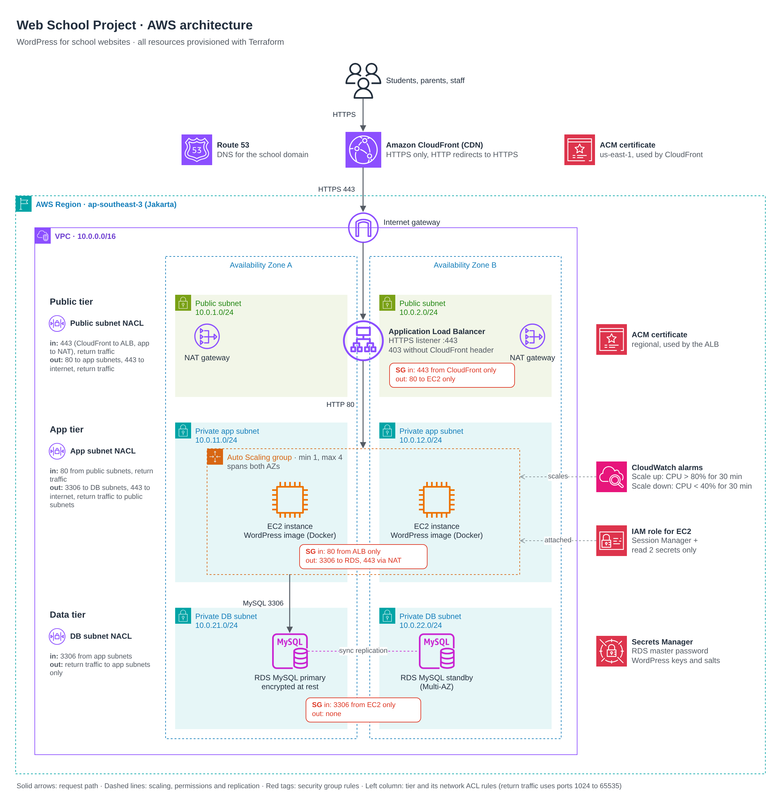

# Web School Project · Design and test report

**Author:** Tut Srikanlayanabuth · October 2026

## Summary

**What was built.** Terraform that provisions a WordPress site for school websites on AWS, in the Asia Pacific (Jakarta) Region, ap-southeast-3. Visitors reach the site through Amazon CloudFront over HTTPS. CloudFront forwards to an Application Load Balancer (ALB) over HTTPS, the ALB forwards to WordPress on Amazon EC2 instances in private subnets, and WordPress stores its data in a Multi-AZ Amazon RDS for MySQL database that only those instances can reach, over TLS. The instances run the official WordPress Docker image in an Auto Scaling group of 1 to 4 instances, which adds an instance when their average CPU stays above 80% for 30 minutes and removes one when it stays below 40% for 30 minutes. The code is a root module that wires together seven modules: network, security, dns, database, alb, compute and cdn.

**How it was tested.** Nothing was deployed: the stack was tested without creating any AWS resources. The evidence, all in `docs/evidence/`, comes in four levels:

1. Static checks: `terraform fmt`, `terraform validate`, TFLint and checkov.
2. 131 plan-time tests (`terraform test` against a mock AWS provider), at least one for every requirement in section 8, and a Node test of the CloudFront Function that redirects www to the apex.
3. A real `terraform plan` against AWS with read-only credentials: 74 resources to add, no errors.
4. A local Docker test of the instances' startup script against MySQL 8.4 with TLS required: 42 checks.

Every test passes. checkov reports 16 findings, each kept on purpose and explained in section 7.2.

**What is out of scope.** AWS WAF, shared storage for media uploads, access and flow logs, DNSSEC and remote state are listed as next steps in section 9, with WAF first. Tests that need a running deployment, such as a real scale-out under load, are listed in the test plan as "Not executed: not deployed".

## 1. Terraform files

The repository holds the Terraform code, its tests and this documentation:

```text
.
├── README.md                 how to check, test, plan and deploy
├── versions.tf  providers.tf  backend.tf
├── main.tf  variables.tf  outputs.tf  terraform.tfvars
├── .terraform.lock.hcl       exact provider versions and checksums
├── .tflint.hcl  .gitignore  .gitattributes
├── modules/                  network, security, dns, database, alb, compute, cdn
├── tests/                    plan-time tests, the CloudFront Function test, the Docker test
└── docs/                     this report, the system diagram, evidence/
```

To run it, from the repository root:

```bash
terraform init
terraform test
node --test "tests/functions/*.test.cjs"
terraform plan
```

- `terraform test` needs no AWS credentials: it plans every module against a mock AWS provider and creates nothing.
- `terraform plan` needs AWS credentials that can read the account. Read-only access is enough, because the plan only looks up data that AWS manages (the CloudFront prefix list and managed policies, the Session Manager policy and the latest Amazon Linux 2023 AMI).
- ap-southeast-3 (Jakarta) is an opt-in Region, so enable it in the account before running `terraform plan`.
- `node --test` needs Node.js 21 or newer and Terraform on the PATH. `bash tests/integration/run.sh` runs the Docker test (bash, curl and Docker Engine 26 or newer).

The `.terraform/` folder is not committed. It holds provider binaries built for one operating system, hundreds of megabytes each, that would not run on a machine with a different one. `.terraform.lock.hcl` pins the exact provider versions (hashicorp/aws 6.70.0, hashicorp/random 3.9.1) with checksums for Linux, macOS and Windows, so `terraform init` rebuilds the same folder anywhere. Terraform state, plan files and local settings are not committed either: `.gitignore` keeps them out.

Built with an AI coding assistant (Claude Code) under my direction. I made the design decisions, reviewed and tested every change.

## 2. System diagram



The request path, step by step:

1. A visitor opens `https://webschool.example`. Route 53 answers with alias records (A and AAAA) for the apex and `www` that point at the CloudFront distribution.
2. CloudFront accepts HTTPS only (plain HTTP is redirected) with the site's certificate from us-east-1. A request for `www` gets a permanent redirect to the same path on the apex. Theme, plugin and core files (`/wp-content/*`, `/wp-includes/*`) are served from the edge cache; pages are not cached.
3. CloudFront connects to the ALB at `origin.webschool.example` over HTTPS, and adds a secret `X-Origin-Verify` header to every request. The ALB's security group admits only CloudFront's addresses.
4. The ALB's only listener is HTTPS on port 443. A request with the right header is forwarded to the WordPress instances; any other request gets a fixed 403.
5. The ALB forwards over HTTP on port 80 inside the VPC to the instances in the private app subnets of two Availability Zones.
6. WordPress connects to RDS for MySQL on port 3306 over TLS. The database and its standby sit in DB subnets with no route to the internet.
7. The instances reach the internet only outbound, on port 443 through a NAT gateway in their own Availability Zone: to Secrets Manager, Session Manager, the container registry and the package repositories.
8. CloudWatch alarms on the group's average CPU add or remove instances, between 1 and 4.

## 3. Module structure

```text
root module (main.tf, variables.tf, outputs.tf, terraform.tfvars, versions.tf, providers.tf, backend.tf)
├── network     VPC, subnets in three tiers over two AZs, internet gateway, NAT gateways, route tables
├── security    security groups and network ACLs
├── dns         Route 53 hosted zone, ACM certificates, DNS validation
├── database    RDS for MySQL, parameter group, error log group, password rotation schedule
├── alb         Application Load Balancer, HTTPS listener and rule, target group, origin record
├── compute     IAM role, WordPress keys secret, launch template, Auto Scaling group, CPU alarms
│   └── templates/user_data.sh.tftpl      startup script for the instances
└── cdn         CloudFront distribution, cache policy, www redirect function, site records
    └── templates/www_redirect.js.tftpl   code of the CloudFront Function
```

There are no sub-modules. Each module covers one concern, and the root module composes all seven, so every connection between modules is visible in one file, the root `main.tf`. The two templates are files that a module renders, not modules.

## 4. Modules, inputs and outputs

In Terraform, modules do not import each other: the root module reads one module's outputs and passes them into another module's inputs, and Terraform works out the order from those references. Every module input has the same name as the output passed into it (`vpc_id = module.network.vpc_id`), so a value cannot reach the wrong input unnoticed.

### Root `main.tf`

Combines all the modules that build the Web School Project.

- A local, `name_prefix = "<project>-<environment>"` (here `web-school-prod`), starts every resource name.
- `random_password.origin_verify` creates the 32-character secret, letters and digits only, that CloudFront sends to the ALB. It is passed to both the alb and cdn modules.
- Seven module calls, in dependency order: network, security, dns, database, alb, compute, cdn.

`providers.tf` sets one AWS provider for ap-southeast-3, with default tags (Project, Environment, Owner, ManagedBy) on every resource. `versions.tf` requires Terraform 1.11 or newer, hashicorp/aws `~> 6.0` and hashicorp/random `~> 3.7`. `backend.tf` holds an S3 backend with encryption and S3-native locking, commented out (see section 6).

### `terraform.tfvars`

Holds the input values for all modules. None of them is secret: the secrets come from Secrets Manager and Terraform-generated values.

```hcl
alb_deletion_protection = true # false only for a throwaway deploy
app_subnet_cidrs        = ["10.0.11.0/24", "10.0.12.0/24"]
aws_region              = "ap-southeast-3" # Jakarta: closest to the schools' visitors, and the database, servers and backups stay in Indonesia
azs                     = ["ap-southeast-3a", "ap-southeast-3b"]
db_deletion_protection  = true  # false only for a throwaway deploy
db_skip_final_snapshot  = false # true only for a throwaway deploy
db_subnet_cidrs         = ["10.0.21.0/24", "10.0.22.0/24"]
domain_name             = "webschool.example" # placeholder: set the school's real domain before applying
environment             = "prod"
owner                   = "Example School Group"
project                 = "web-school"
public_subnet_cidrs     = ["10.0.1.0/24", "10.0.2.0/24"]
vpc_cidr                = "10.0.0.0/16"
wordpress_image         = "public.ecr.aws/docker/library/wordpress:7.1.3-php8.3-apache" # Docker's official image, mirrored on ECR Public
```

### Root `outputs.tf`

Displays the final output once the Web School Project is deployed: what an operator needs after an apply. None is sensitive; they hold names and ARNs, never secret values.

| Output | Value | Use |
|---|---|---|
| `website_url` | `https://<domain_name>` | the site's address |
| `name_servers` | from module dns | to set at the domain's registrar |
| `cloudfront_domain_name` | from module cdn | the distribution that the apex and www point at |
| `cloudfront_distribution_id` | from module cdn | for cache invalidations |
| `alb_dns_name` | from module alb | troubleshooting; only CloudFront can connect |
| `asg_name` | from module compute | the Auto Scaling group to watch |
| `db_endpoint` | `<address>:<port>` from module database | the form WordPress connects to |
| `db_secret_arn` | from module database | where RDS keeps the master password |

### Root `variables.tf`

Declares the variables that the root `main.tf` uses. Each has a type and a description, and the modules validate the values they receive (CIDR blocks, Availability Zones, the domain name, the image tag, the origin secret).

| Variable | Type | Used by |
|---|---|---|
| `aws_region` | string | the provider |
| `project`, `environment`, `owner` | string | resource names and tags |
| `vpc_cidr`, `azs` | string, list(string) | network |
| `public_subnet_cidrs`, `app_subnet_cidrs`, `db_subnet_cidrs` | list(string) | network |
| `domain_name` | string | dns, alb, compute, cdn |
| `db_deletion_protection`, `db_skip_final_snapshot` | bool | database |
| `alb_deletion_protection` | bool | alb |
| `wordpress_image` | string | compute |

### Module network

The VPC and its subnets: a public, an app and a DB subnet in each of two Availability Zones, an internet gateway, one NAT gateway per Availability Zone, and route tables. It also takes over the VPC's default security group and default network ACL and removes all their rules.

| Input | Comes from |
|---|---|
| `name_prefix` | `local.name_prefix` |
| `vpc_cidr`, `azs` | root variables |
| `public_subnet_cidrs`, `app_subnet_cidrs`, `db_subnet_cidrs` | root variables |

| Output | Goes to |
|---|---|
| `vpc_id` | security, alb |
| `public_subnet_ids`, `public_subnet_cidrs` | security, alb (IDs) |
| `app_subnet_ids`, `app_subnet_cidrs` | security, compute (IDs) |
| `db_subnet_ids`, `db_subnet_cidrs` | security, database (IDs) |

### Module security

The three security groups (ALB, app, DB) with their rules, and one network ACL per subnet tier.

| Input | Comes from |
|---|---|
| `name_prefix` | `local.name_prefix` |
| `vpc_id` | module network |
| `public_subnet_ids`, `app_subnet_ids`, `db_subnet_ids` | module network |
| `public_subnet_cidrs`, `app_subnet_cidrs`, `db_subnet_cidrs` | module network |

| Output | Goes to |
|---|---|
| `alb_sg_id` | alb |
| `app_sg_id` | compute |
| `db_sg_id` | database |

### Module dns

The public hosted zone for the domain, and two certificates validated through DNS: one in us-east-1 for the apex and `www` (CloudFront only accepts certificates from that Region), and one in ap-southeast-3 for `origin.<domain>` (the ALB).

| Input | Comes from |
|---|---|
| `name_prefix` | `local.name_prefix` |
| `domain_name` | root variable |

| Output | Goes to |
|---|---|
| `zone_id` | alb, cdn |
| `alb_certificate_arn` | alb |
| `cloudfront_certificate_arn` | cdn |
| `name_servers` | root output |

The certificate ARNs come from the validation resources, so the ALB and CloudFront are only created once ACM has issued the certificates.

### Module database

RDS for MySQL 8.4 with a standby in the second Availability Zone, its subnet group, a parameter group that requires TLS, the error log group, and the rotation schedule of the master password.

| Input | Comes from |
|---|---|
| `name_prefix` | `local.name_prefix` |
| `db_subnet_ids` | module network |
| `db_sg_id` | module security |
| `deletion_protection` | root variable `db_deletion_protection` |
| `skip_final_snapshot` | root variable `db_skip_final_snapshot` |

| Output | Goes to |
|---|---|
| `db_address`, `db_port`, `db_name` | compute; address and port also make the root output `db_endpoint` |
| `db_secret_arn` | compute, root output |

### Module alb

The internet-facing ALB in both public subnets, its HTTPS listener, the rule that checks the origin secret, the target group for the instances, and the `origin.<domain>` record.

| Input | Comes from |
|---|---|
| `name_prefix` | `local.name_prefix` |
| `vpc_id`, `public_subnet_ids` | module network |
| `alb_sg_id` | module security |
| `alb_certificate_arn`, `zone_id` | module dns |
| `domain_name` | root variable |
| `origin_verify_secret` | `random_password.origin_verify` (sensitive) |
| `deletion_protection` | root variable `alb_deletion_protection` |

| Output | Goes to |
|---|---|
| `target_group_arn` | compute |
| `origin_fqdn` | cdn |
| `alb_dns_name` | root output |

### Module compute

The instances' IAM role, the secret with WordPress's keys and salts, the launch template with its startup script, the Auto Scaling group, the two scaling policies and the two CPU alarms.

| Input | Comes from |
|---|---|
| `name_prefix` | `local.name_prefix` |
| `app_subnet_ids` | module network |
| `app_sg_id` | module security |
| `target_group_arn` | module alb |
| `db_address`, `db_port`, `db_name`, `db_secret_arn` | module database |
| `domain_name`, `wordpress_image` | root variables |
| `min_size` (1), `max_size` (4), `scale_out_cpu_threshold` (80), `scale_in_cpu_threshold` (40), `instance_type` (t3.small), `ami_id` (latest Amazon Linux 2023) | module defaults |

| Output | Goes to |
|---|---|
| `asg_name` | root output |
| `instance_role_arn` | available for other stacks; not used by the root |

### Module cdn

The CloudFront distribution, the cache policy for static files, the CloudFront Function that redirects www to the apex, and the A and AAAA records for the apex and `www`.

| Input | Comes from |
|---|---|
| `name_prefix` | `local.name_prefix` |
| `domain_name` | root variable |
| `origin_fqdn` | module alb |
| `cloudfront_certificate_arn`, `zone_id` | module dns |
| `origin_verify_secret` | `random_password.origin_verify` (sensitive) |

| Output | Goes to |
|---|---|
| `cloudfront_domain_name`, `distribution_id` | root outputs |

Each module's `README.md` describes it in more detail and ends with a generated reference of its inputs and outputs.

## 5. Configuration and security measures

Sections 5.1 to 5.3 cover the three required security measures: HTTPS, traffic filtering and least-privilege IAM. 5.4 lists the further measures, and 5.5 the configuration of each part.

### 5.1 HTTPS for CloudFront and the ALB

Traffic is encrypted on every hop that leaves the VPC, and on the hop to the database.

| Hop | Protocol and settings | Why |
|---|---|---|
| Visitor to CloudFront | HTTPS only: plain HTTP is redirected. Security policy `TLSv1.2_2021` (TLS 1.3 and 1.2), SNI, HTTP/2 and HTTP/3. Certificate from ACM in us-east-1 for the apex and `www`. | CloudFront only accepts certificates from us-east-1. The 2021 policy keeps the ChaCha20 ciphers, which phones without AES hardware run faster. |
| HSTS | `Strict-Transport-Security` for one year on every response, from the managed security headers policy | Browsers then use HTTPS for the site without trying plain HTTP first. |
| CloudFront to the ALB | HTTPS only, origin protocol TLSv1.2, to `origin.webschool.example` | The ALB's own DNS name is on no certificate we can get, so CloudFront connects by a name that the ALB's certificate covers. |
| ALB listener | One listener, HTTPS on 443, policy `ELBSecurityPolicy-TLS13-1-2-Res-PQ-2025-09`, certificate from ACM in ap-southeast-3. No port 80 listener. | AWS's current recommended policy: TLS 1.3 and 1.2 only, with AES-GCM-only ciphers for TLS 1.2. Without a policy, the API default `ELBSecurityPolicy-2016-08` still allows TLS 1.0. |
| ALB to the instances | HTTP on port 80, inside the VPC | TLS ends at the ALB. The instances are in private subnets, and only the ALB's security group can reach them. TLS to the instances is a next step. |
| Instances to RDS | MySQL with TLS required: the parameter group sets `require_secure_transport = 1`, and WordPress sets `MYSQL_CLIENT_FLAGS` to `MYSQLI_CLIENT_SSL` | RDS for MySQL accepts plain-text connections by default. With the server enforcing TLS, no client can connect without it. |

Visitors whose browsers support it get CloudFront's hybrid post-quantum key exchange, over TLS 1.3 only. CloudFront connects to origins with classical key exchange, so the post-quantum part of the ALB's policy is not used on this path; the two sides agree on ECDHE-RSA with AES-GCM. WordPress encrypts its database connection but does not check the server's certificate: WordPress 7.1.3 has no setting for a database CA, and adding the RDS CA to PHP's trust store would change TLS trust for all PHP code. That check is a next step.

### 5.2 Security groups and network ACLs

Two layers filter traffic to the instances and the database, in both directions. Security groups are stateful (the reply to an allowed connection is let back in automatically) and filter per resource. Network ACLs are stateless (every reply needs its own rule) and filter per subnet tier.

**Security groups**

| Group | Inbound | Outbound | Why |
|---|---|---|---|
| ALB | 443 from the AWS-managed prefix list `com.amazonaws.global.cloudfront.origin-facing` | 80 to the app group | Only CloudFront can open a connection to the ALB, and the ALB can only talk to the instances. |
| App (instances) | 80 from the ALB group | 3306 to the DB group; 443 to 0.0.0.0/0 | The instances take requests only from the ALB, and leave the VPC only for HTTPS through the NAT gateways. |
| DB (RDS) | 3306 from the app group | none | Only the instances can reach MySQL, and RDS opens no connections of its own. |
| VPC default | none | none | Anything launched without a security group gets no access. |

The rules name security groups, not address ranges, so only members of the source group are allowed, wherever their addresses are. Terraform removes the allow-all outbound rule that AWS adds to every new group.

**Network ACLs**

| Network ACL | Inbound | Outbound | Why |
|---|---|---|---|
| Public subnets (ALB, NAT gateways) | 443 from 0.0.0.0/0; 1024-65535 from 0.0.0.0/0 | 80 to the app subnets; 443 to 0.0.0.0/0; 1024-65535 to 0.0.0.0/0 | HTTPS from CloudFront to the ALB and from the instances to the NAT gateways; HTTP from the ALB to the instances; replies both ways. |
| App subnets (instances) | 80 from the public subnets; 1024-65535 from 0.0.0.0/0 | 3306 to the DB subnets; 443 to 0.0.0.0/0; 1024-65535 to the public subnets | Requests from the ALB; MySQL to RDS; HTTPS out; replies from RDS and from the internet through the NAT gateways, and replies to the ALB. |
| DB subnets (RDS) | 3306 from the app subnets | 1024-65535 to the app subnets | MySQL from the instances and its replies, nothing else. |
| VPC default | none | none | A subnet left on it gets no traffic. |

- Everything not listed is denied.
- Replies go to the port the other side picked, so the reply rules cover 1024-65535. NAT gateways use that whole range, so a narrower range would drop some connections.
- Rules that cover a tier get one entry per subnet, not the whole VPC.
- The DB subnets' route table has no route to the internet.
- No subnet gives instances a public IP.
- Routes and network ACL rules are written inline, so Terraform deletes any rule or route added by hand at the next apply.
- Security groups and network ACLs do not filter traffic to the VPC's DNS resolver, the instance metadata service or the Amazon Time Sync Service, so these need no rules.

### 5.3 IAM roles with minimum permissions

The only IAM role is the one the WordPress instances run as. Only EC2 can assume it (`sts:AssumeRole` for `ec2.amazonaws.com`). It has exactly two permissions:

| Policy | Actions | Resources | Why |
|---|---|---|---|
| Inline policy `read-wordpress-secrets` | `secretsmanager:GetSecretValue` | the RDS-managed master user secret and the WordPress keys secret, by ARN | The instances read the database credentials and WordPress's keys at boot and every minute. No KMS permission is needed: the AWS managed key lets any principal that may read a secret decrypt it. |
| AWS managed policy `AmazonSSMManagedInstanceCore`, looked up by name | `ssm`: 15 actions for registering and reporting the instance (such as `UpdateInstanceInformation`, `ListAssociations`, `GetDocument`, `GetParameter`); `ssmmessages`: `CreateControlChannel`, `CreateDataChannel`, `OpenControlChannel`, `OpenDataChannel`; `ec2messages`: 6 message actions | `*` | Session Manager gives shell access through IAM and CloudTrail instead of SSH: no key pair, no port 22, no bastion host. |

- The role cannot touch S3, EC2, IAM or any other secret.
- The container cannot use the role at all: the instance metadata hop limit is 1 (section 5.4).
- One honest caveat: the managed policy is AWS's standard policy for Systems Manager, and it is broader than Session Manager alone needs. For example, it allows `ssm:GetParameter` on every parameter in the account. AWS documents a narrower custom policy for Session Manager only (`ssm:UpdateInstanceInformation` plus the four `ssmmessages` actions); using it is a next step.

The stack creates no other role: the ALB and CloudFront need none, and RDS creates, stores and rotates its master password itself.

### 5.4 Further security measures

| Measure | How | Why |
|---|---|---|
| Origin secret | CloudFront adds `X-Origin-Verify` with a 32-character random value. The ALB's rule forwards only requests that carry it; anything else gets a fixed 403. | The CloudFront prefix list admits every CloudFront distribution in AWS, including other people's. The secret tells ours apart. It has letters and digits only, because the ALB treats `*` and `?` in header values as wildcards. |
| IMDSv2 with hop limit 1 | `http_tokens = "required"`, `http_put_response_hop_limit = 1`, and the container on Docker's default bridge network | The metadata token cannot cross the extra network hop into the container, so a compromised WordPress cannot take the instance role's credentials. Amazon Linux 2023 sets 2 by default, to let containers in. |
| Secrets as files, not variables | A host script reads both secrets every minute into files in `/run/wordpress` (memory only, owned by the web server user, mode 0400), mounted read-only into the container. WordPress reads each file on every request. | No secret is in the startup script, a command line, the container's environment or on disk. A rotated password reaches WordPress within a minute, without a restart. |
| A bad fetch keeps the old files | The script stages every file and checks each value (present, not null, not empty) before replacing any | A failed refresh never breaks a working site. The Docker test proves it for seven kinds of failure. |
| Database password managed by RDS | `manage_master_user_password = true`; RDS keeps the password in Secrets Manager and rotates it weekly, moved to Sunday 02:00 to 04:00 Jakarta time, when school sites are quiet | The password is never in the code, the plan or the state. |
| WordPress keys never stored by Terraform | Eight 64-character values from an ephemeral `random_password`, written through the write-only `secret_string_wo` | Anyone with the keys can forge login cookies. Ephemeral values are never saved, so the keys are in neither the plan nor the state. The origin secret, a normal `random_password`, is in the state, which is why the state must stay private. |
| Encryption at rest | RDS storage and the instances' root volumes are encrypted, as are both secrets (AWS managed keys) and the database's error log (CloudWatch Logs encrypts by default) | Data on disk and in backups is unreadable without the keys. |
| Security headers | AWS's managed security headers policy on every response: HSTS, `X-Content-Type-Options: nosniff`, `X-Frame-Options: SAMEORIGIN`, `Referrer-Policy`. WordPress's own value wins for every header except `X-Content-Type-Options`, which is always set. | Browser-side protection against downgrade, MIME sniffing and clickjacking, at no cost. |
| WordPress cannot change its own code | `DISALLOW_FILE_MODS` and `AUTOMATIC_UPDATER_DISABLED` | Every instance runs exactly the pinned image's code, and a stolen admin login cannot upload PHP through the plugin installer. Updates come with a new image tag. |
| Pinned image | The image tag must be a full version such as `7.1.3-php8.3-apache`; `latest` and floating tags are rejected | Every instance runs the same WordPress, PHP and Apache. |
| Invalid headers dropped | `drop_invalid_header_fields = true` on the ALB | Malformed headers never reach WordPress. |
| Protection from deletion | Deletion protection on the ALB and the database, and a final snapshot when the database is deleted | A mistaken `terraform destroy` cannot remove them. |

### 5.5 Configuration of each part

**Network**

| Setting | Value | Why |
|---|---|---|
| VPC | `10.0.0.0/16`, DNS support and host names on | Instances resolve AWS names such as the RDS endpoint. |
| Subnets | public `10.0.1.0/24`, `10.0.2.0/24`; app `10.0.11.0/24`, `10.0.12.0/24`; DB `10.0.21.0/24`, `10.0.22.0/24` | One of each tier in each Availability Zone (ap-southeast-3a and 3b), keyed by zone, so removing or reordering a zone never recreates the others. |
| NAT gateways | one per Availability Zone, each app subnet routed to its own | If one zone fails, the other keeps its way out. |

**DNS and certificates**

| Setting | Value | Why |
|---|---|---|
| Hosted zone | public, for `domain_name` | Terraform creates it, so the stack owns all its records. |
| Records | apex and `www`: A and AAAA aliases to CloudFront; `origin`: A alias to the ALB | IPv4 and IPv6 for visitors. Alias records cost nothing and follow the target's addresses. |
| Certificates | DNS-validated; created before the old ones are deleted | ACM cannot delete a certificate that is still in use. |

**CloudFront**

| Setting | Value | Why |
|---|---|---|
| Pages (default behaviour) | not cached (`Managed-CachingDisabled`); all methods; viewer headers, cookies and query strings forwarded, except Host | Pages change for logged-in users. If CloudFront forwarded the visitor's Host, it would check the ALB's certificate against the visitor's domain, which that certificate does not cover, and the request would fail. |
| `/wp-content/*`, `/wp-includes/*` | cached 24 hours by default (1 year at most), compressed, GET and HEAD only; cache key includes only the `ver` query string | WordPress adds `?ver=<version>` to its CSS and JavaScript, so a new version gets new URLs at the edge and in browsers. Only `ver`, so extra parameters cannot bypass the cache. |
| www | a CloudFront Function on page requests answers `www.<domain>` with a 301 to the same path and query on the apex | WordPress builds every link, font and script on the apex. On www, browsers would block the apex's fonts and the module scripts of interactive blocks such as the mobile menu, because Apache sends no CORS headers. The domain comes from Terraform, so the function cannot redirect anywhere else. |
| Price class | `PriceClass_200` | Includes edge locations in Indonesia and Asia, without the most expensive regions. |

**ALB**

| Setting | Value | Why |
|---|---|---|
| Target group | HTTP 80; health check on `/` accepting 200-399; 30 seconds of draining | WordPress answers `/` with a redirect before it is installed, and when the request's host name is not the site's, as in the ALB's health check, so `200` alone would mark healthy instances as failing. WordPress requests finish in seconds; the default 300-second draining would slow every scale-in. |

**Compute**

| Setting | Value | Why |
|---|---|---|
| AMI | latest Amazon Linux 2023 (x86_64), from AWS's public SSM parameter; `ami_id` pins one | A new AMI rolls out at the next apply, which keeps the instances patched. |
| Instance | t3.small, 20 GB encrypted gp3 root volume, no public IP, no key pair | Room for Docker and the image; access through Session Manager only. |
| Startup | `user_data` installs Docker and has systemd run the official WordPress image from ECR Public (`public.ecr.aws/docker/library/wordpress:7.1.3-php8.3-apache`) | ECR Public mirrors Docker's official image with the same digest, without Docker Hub's limit of 100 anonymous pulls per 6 hours, which all instances behind one NAT gateway would share. |
| WordPress settings | `WP_HOME` and `WP_SITEURL` set to `https://<domain>` | WordPress sees the Host `origin.<domain>`, and must build links on the public address. |
| Rollout | the group launches the launch template's latest version; an instance refresh starts new instances and waits for them to be healthy before stopping old ones (min 100%, max 200% healthy) | A new AMI, image tag or startup script rolls out with no drop in capacity. |
| Tags | the provider's default tags, copied onto the instances, their volumes and the group | Default tags do not reach what an Auto Scaling group launches. |

**Auto Scaling**

| Setting | Value | Why |
|---|---|---|
| Group | min 1, max 4, across both app subnets; ELB health checks with a 300-second grace period; no desired capacity set | The required range (section 8). The group replaces any instance the ALB marks unhealthy. Setting a desired capacity would make every apply undo the scaling. |
| Scale out | alarm when average `CPUUtilization` > 80 for 6 periods of 300 seconds (30 minutes); policy adds 1 instance; cooldown 300 seconds | 6 x 300 s = 30 minutes. EC2 basic monitoring reports every 5 minutes, so a shorter period would have no data. |
| Scale in | alarm when average `CPUUtilization` < 40 for 6 periods of 300 seconds; policy removes 1 instance; cooldown 300 seconds | Target tracking aims at one CPU value, so it cannot express two thresholds; two alarms with simple scaling can. |

**Database**

| Setting | Value | Why |
|---|---|---|
| Engine | MySQL 8.4 (RDS picks and patches the minor version), db.t3.micro | MySQL 8.0 left RDS standard support on 31 July 2026; 8.4 has it until 31 July 2029. |
| Availability | Multi-AZ | A standby in the other zone takes over if the primary or its zone fails. |
| Storage | gp3, 20 GB growing on its own up to 100 GB, encrypted | 20 GB is the gp3 minimum; storage autoscaling avoids running out. |
| Access | not publicly accessible; DB subnets only; the DB security group only | Only the instances can reach it. |
| Backups | 7 days, tags copied to snapshots | Point-in-time recovery for a week. |
| Error log | published to CloudWatch Logs, in a log group that Terraform creates first, kept 365 days | A log group that RDS creates itself never expires by default and sits outside Terraform. Creating it first lets Terraform set and keep the 365-day retention. |
| Password rotation | weekly, Sunday 02:00 to 04:00 Jakarta time (`cron(0 19 ? * SAT *)` in UTC, 2-hour window), not on apply | Each rotation can cost up to about a minute of database errors before the instances pick up the new password, so it falls when school sites are quiet. |

## 6. Best practices

| Practice | Where | Why |
|---|---|---|
| One module per concern | seven modules, composed only in the root `main.tf` | Each part can be read, tested and changed on its own, and every connection between them is in one place. |
| Inputs named after the outputs passed into them | root `main.tf` | Swapping two look-alike subnet lists would plan without errors; matching names make a swap visible. |
| Pinned versions | Terraform 1.11 or newer; hashicorp/aws `~> 6.0` and hashicorp/random `~> 3.7` in the root; minimums only in the modules; `.terraform.lock.hcl` pins the exact versions with checksums | Every machine runs the same providers, and an upgrade is a deliberate change. This follows HashiCorp's guidance for root and child modules. |
| Default tags | provider `default_tags`: Project, Environment, Owner, ManagedBy; copied onto the Auto Scaling group, its instances and volumes | Cost tracking and ownership for every resource. |
| Remote state, written but switched off | `backend.tf`: S3 backend with encryption and S3-native locking, commented out | The plan credentials are read-only and cannot write state or a lock file. To switch: create the bucket, uncomment the block, run `terraform init -migrate-state`. |
| No secrets in code, variables or the plan | secrets come from RDS, Secrets Manager and Terraform-generated values; `terraform.tfvars` holds only non-secret values; secret variables are marked `sensitive` | The plan in `docs/evidence/plan.txt` shows secrets only as "(sensitive value)" or "(write-only attribute)". |
| Validated inputs | CIDR blocks, Availability Zones, domain name, image tag, AMI ID, group sizes, CPU thresholds, origin secret, certificate Region | Mistakes fail at plan time with a clear message, instead of at apply. |
| Safe replacement | `create_before_destroy` on security groups, certificates, the target group and the parameter group, with name prefixes where AWS needs unique names | AWS refuses to delete each of these while it is in use, so the replacement must exist first. |
| Drift removed | routes and network ACL rules inline; the default security group and network ACL emptied | A rule added by hand shows in the next plan and is removed by the next apply. |
| Checks on every change | `terraform fmt`, `terraform validate`, TFLint (all rules, plus the AWS ruleset), checkov, 131 plan-time tests, the Node test and the Docker test | Outputs in `docs/evidence/`. |
| Documentation with the code | a README for the repository and each module, with a reference that terraform-docs generates from the code | The reference cannot drift from the variables and outputs. |
| Line endings | `.gitattributes` forces LF for every file | A startup script with Windows line endings fails at boot. |

## 7. Test plan and results

The tests check that the stack works and that it is secure. They come in five levels, from cheapest to most real. Results: **Pass**; **Executed locally (Docker), not on AWS**; **Executed locally (Node), not on the edge**; and **Not executed: not deployed**. All evidence is in `docs/evidence/` and was captured from the code in this repository's initial commit. Each file starts with the command that produced it, except `integration-test.txt`, which starts with the run's date and the digests of the images it used.

### 7.1 Test plan and results

**Level 1: static checks**

| ID | Requirement | Method | Expected | Result | Evidence |
|---|---|---|---|---|---|
| S1 | Code is formatted | `terraform fmt -check -recursive` | no file to change | Pass | fmt.txt |
| S2 | Configuration is valid | `terraform validate` | valid | Pass | validate.txt |
| S3 | Lint | TFLint 0.64.0, all rules, AWS ruleset 0.49.0 | no issues | Pass | tflint.txt |
| S4 | Security scan | checkov 3.3.30 | no finding without a reason | Pass: 128 passed; 16 findings kept and 9 checks skipped, each explained in 7.2 | checkov.txt |

**Level 2: plan-time tests.** `terraform test` plans each module, and the root with `terraform.tfvars`, against a mock AWS provider: 131 test runs in `tests/*.tftest.hcl`, all passing (evidence: terraform-test.txt). Appendix A lists the runs behind each ID.

| ID | Requirement | Method (test file, runs) | Expected | Result |
|---|---|---|---|---|
| T01 | Network layout | network, 8 | VPC `10.0.0.0/16`; three subnet tiers in two zones as planned; one NAT gateway per zone in its own public subnet; no public IPs | Pass |
| T02 | Routing | network, 5 | public subnets to the internet gateway; each app subnet to the NAT gateway in its own zone; DB subnets with no route out | Pass |
| T03 | Default security group and network ACL locked | network, 2 | no rules at all | Pass |
| T04 | Network inputs validated | network, 6 | bad or IPv6 CIDR, one zone, a repeated zone, mismatched lists rejected | Pass |
| T05 | Security groups match the traffic table | security, 4 | exactly the rules in 5.2; every description uses only characters AWS allows | Pass |
| T06 | Network ACLs match the traffic table | security, 6 | each ACL's complete rule set in each direction, on its own tier's subnets; bad CIDRs rejected | Pass |
| T07 | Certificates and DNS validation | dns, 6 | public zone; CloudFront certificate in us-east-1 for the apex and www; ALB certificate for the origin name; one validation record per name | Pass |
| T08 | Domain name validated by every module that uses it | dns 4, alb 1, compute 1, cdn 1 | a scheme, trailing dot, uppercase, wildcard or quote rejected | Pass |
| T09 | RDS MySQL, private | database, 4 | MySQL 8.4 on db.t3.micro in the DB subnets; not publicly accessible; only the DB group; one subnet rejected | Pass |
| T10 | RDS data protected | database, 4 | Multi-AZ; encrypted gp3; TLS required; password managed by RDS and rotated Sunday 02:00 to 04:00 Jakarta time | Pass |
| T11 | RDS operations | database, 6 | 7-day backups; error log exported and kept 365 days; deletion protection and final snapshot on by default | Pass |
| T12 | ALB placement and hardening | alb, 4 | internet-facing in both public subnets; invalid headers dropped; deletion protection; one subnet rejected | Pass |
| T13 | ALB serves HTTPS only | alb, 1 | one listener, HTTPS 443, the TLS 1.3 and 1.2 policy, default fixed 403 | Pass |
| T14 | Only our CloudFront reaches WordPress | alb 3, cdn 3 | the rule forwards only with the origin secret; CloudFront sends it on every origin request; secrets with wildcards or under 32 characters rejected | Pass |
| T15 | Target group and origin name | alb, 3 | HTTP 80, health check on `/` accepting 200-399; `origin.<domain>` points at the ALB | Pass |
| T16 | IAM least privilege | compute, 4 | only EC2 can assume the role; Session Manager policy; `GetSecretValue` on exactly the two secrets; instances use the profile | Pass |
| T17 | WordPress keys out of the plan and state | compute, 1 | eight keys from ephemeral passwords through the write-only argument | Pass |
| T18 | Launch template | compute, 7 | latest Amazon Linux 2023 or a pinned AMI; t3.small; no key pair; no public IP; only the app group; encrypted 20 GB gp3; tags; a bad AMI ID rejected | Pass |
| T19 | IMDSv2 with hop limit 1 | compute, 1 | tokens required, hop limit 1 | Pass |
| T20 | Startup script | compute, 5 | the pinned image on port 80; secrets only through files; never `set -x` or the host network; refresh every minute; site address and TLS to the database; no file changes | Pass |
| T21 | Pinned image tag | compute, 5 | full version tag accepted; `latest`, no tag, a floating version and the FPM variant rejected | Pass |
| T22 | Auto Scaling group of 1 to 4 | compute, 8 | min 1, max 4, both app subnets, ELB health checks, rolling refresh 100%/200%, tags; min above max, max 0 and one subnet rejected | Pass |
| T23 | Scale up above 80% for 30 minutes | compute, 2 | alarm on average CPU > 80 for 6 x 300 s triggers a policy that adds 1 instance | Pass |
| T24 | Scale down below 40% for 30 minutes | compute, 2 | alarm on average CPU < 40 for 6 x 300 s triggers a policy that removes 1 instance | Pass |
| T25 | Scaling inputs validated | compute, 4 | a threshold over 100, a negative one, and a scale-in threshold not below scale-out rejected | Pass |
| T26 | CloudFront serves HTTPS | cdn, 4 | apex and www; HTTP redirected; `TLSv1.2_2021` with SNI; origin over HTTPS only with TLS 1.2; a certificate outside us-east-1 rejected | Pass |
| T27 | CloudFront caching and headers | cdn, 4 | pages not cached and Host not forwarded; static files cached with only `ver` in the key; security headers on every behaviour | Pass |
| T28 | Site records | cdn, 3 | A and AAAA aliases for the apex and www, with `evaluate_target_health = false` | Pass |
| T29 | www redirect wiring | cdn, 1 | a published `cloudfront-js-2.0` function, on page requests only, before the cache | Pass |
| T30 | Root wiring and safe values | root, 7 | each module gets the right values; `terraform.tfvars` keeps deletion protection and the final snapshot on; origin secret of 32 letters and digits | Pass |
| T31 | Root outputs | root, 1 | each of the eight outputs shows the right value | Pass |

**Level 3: the real plan.** `terraform plan` against AWS with credentials that have only the ReadOnlyAccess policy (evidence: plan.txt).

| ID | Requirement | Method | Expected | Result |
|---|---|---|---|---|
| P1 | The whole stack plans against the real AWS API | `terraform plan`, read-only credentials | 74 to add, 0 to change, 0 to destroy, no errors | Pass |
| P2 | No secret in the plan | read plan.txt | origin secret "(sensitive value)"; the CloudFront origin and the ALB rule condition hidden because they hold it; WordPress keys and the database password "(write-only attribute)" or not set | Pass |
| P3 | AWS-managed lookups resolve | read plan.txt | real IDs for the CloudFront prefix list, the managed cache, origin request and headers policies, the Amazon Linux 2023 AMI and the Session Manager policy | Pass |
| P4 | Certificates in the right Regions | read plan.txt | CloudFront certificate and its validation in us-east-1, ALB certificate in ap-southeast-3, one validation record per name known at plan time | Pass |
| P5 | Root outputs | read plan.txt | `website_url` and `asg_name` known; the rest known after apply | Pass |

Because the plan hides the CloudFront origin and the ALB rule condition, their settings (HTTPS only, TLS 1.2, the header name) are covered by T13, T14 and T26.

**Level 4: local tests of code that runs outside Terraform**

| ID | Requirement | Method | Expected | Result | Evidence |
|---|---|---|---|---|---|
| N1 | The www redirect function behaves | Node renders the function from its template with `terraform console` and runs it against 6 requests | www gets a 301 to the same path and query on the apex; the apex and other hosts pass through; host case ignored | Executed locally (Node), not on the edge | node-test.txt |
| D1 | The startup script runs on Amazon Linux 2023 | Docker: Amazon Linux 2023 container, 5 checks | the script and the secrets script are valid bash; `dnf` installs Docker and jq; systemd accepts the three units; the secrets script runs as root | Executed locally (Docker), not on AWS | integration-test.txt |
| D2 | Secrets reach WordPress only as protected files | Docker, 5 checks | 10 files owned by the web server user with mode 0400; that user can read them and no other can; the folder is read-only in the container; no secret value in the container's environment | Executed locally (Docker), not on AWS | integration-test.txt |
| D3 | TLS to the database is required | Docker: MySQL 8.4 with `require_secure_transport=ON`, 4 checks | WordPress connects over TLS; the same WordPress without the TLS flag is refused (HTTP 500) | Executed locally (Docker), not on AWS | integration-test.txt |
| D4 | WordPress settings | Docker, 1 check | the settings are valid PHP with the site address, TLS and no file changes | Executed locally (Docker), not on AWS | integration-test.txt |
| D5 | Password rotation without a restart | Docker, 4 checks | after the password changes WordPress fails, the script writes the new one, and WordPress works again without a container restart | Executed locally (Docker), not on AWS | integration-test.txt |
| D6 | A bad secret fetch keeps the site up | Docker, 23 checks | for 7 kinds of bad fetch (CLI fails; prints nothing, null or None; password null, empty or missing) the script stops, every old file stays, no staging folder is left; WordPress still works | Executed locally (Docker), not on AWS | integration-test.txt |

The Docker test uses a fake AWS CLI and a local MySQL, so it does not test IAM, Secrets Manager, the metadata hop limit, RDS itself or systemd at run time; `tests/integration/README.md` lists exactly what it proves and what it does not.

**Level 5: post-deployment tests.** These need a running stack, so none was executed. Each is ready to run after an apply.

| ID | Requirement | Method | Expected | Result |
|---|---|---|---|---|
| X1 | HTTP is redirected to HTTPS | `curl -I http://webschool.example/` | 301 to `https://webschool.example/` | Not executed: not deployed |
| X2 | www is redirected to the apex | `curl -I "https://www.webschool.example/news?page=2"` | 301 to `https://webschool.example/news?page=2` | Not executed: not deployed |
| X3 | The ALB cannot be reached directly | `curl https://<alb_dns_name>/` from the internet; a request through another CloudFront distribution | the first times out (security group); the second gets 403 (no secret) | Not executed: not deployed |
| X4 | RDS is unreachable from the internet | connect to `db_endpoint` from outside the VPC | the name resolves to a private address; no connection | Not executed: not deployed |
| X5 | No SSH; Session Manager works | port 22 on an instance; `aws ssm start-session` | no port 22 open; the session starts | Not executed: not deployed |
| X6 | Scale up under load | CPU load above 80% on the instances for 30 minutes | the high alarm fires and the group adds 1 instance per cooldown, up to 4 | Not executed: not deployed |
| X7 | Scale down after load | CPU below 40% for 30 minutes | the low alarm fires and the group removes 1 instance per cooldown, down to 1 | Not executed: not deployed |
| X8 | Static files cached | request a theme file twice; change `?ver=` | second response `X-Cache: Hit from cloudfront`; a new `ver` is a miss | Not executed: not deployed |
| X9 | Security headers present | `curl -I https://webschool.example/` | `strict-transport-security`, `x-content-type-options`, `x-frame-options`, `referrer-policy` | Not executed: not deployed |
| X10 | The container cannot reach the role | from the WordPress container, request an IMDSv2 token | no response | Not executed: not deployed |
| X11 | Password rotation on RDS | rotate the master secret | the site recovers within about a minute without a restart | Not executed: not deployed |

### 7.2 checkov: skipped checks and kept findings

Skipped inline, each with the reason written next to the code:

| Check | Resource | Reason |
|---|---|---|
| CKV2_AWS_5: security group attached | the ALB, app and DB groups | False positive: the check cannot follow security group IDs through module outputs. The groups are attached in the alb, compute and database modules, which T09, T12 and T18 check. |
| CKV2_AWS_1: network ACL attached | the public, app and DB network ACLs | False positive for the same reason: the subnet IDs come from the network module. T06 checks the attachments. |
| CKV_AWS_260: port 80 open to 0.0.0.0/0 | the app group's HTTP rule | False positive: the rule's only source is the ALB's security group, through `referenced_security_group_id`, an argument the check does not read (checkov 3.3.30 and its current source). |
| CKV_AWS_378: target group uses HTTP | the target group | False positive: the check accepts an HTTP target group only when a listener forwards to it directly, and ours is reached through the listener rule. TLS ends at the ALB by design; TLS to the instances is a next step. |
| CKV_AWS_305: default root object | the CloudFront distribution | Not applicable: a default root object is for static origins such as S3. WordPress serves `/` itself. |

Findings kept, each a deliberate choice:

| Check | Resource | Reason |
|---|---|---|
| CKV_AWS_68, CKV2_AWS_47: WAF on CloudFront; CKV2_AWS_28: WAF on the ALB | distribution, ALB | AWS WAF is the first next step (section 9). Until then, the security group and the origin secret keep the ALB reachable only through our distribution. |
| CKV_AWS_86: CloudFront access logs; CKV_AWS_91: ALB access logs | distribution, ALB | A next step, with an S3 log bucket and a retention period. |
| CKV2_AWS_11: VPC flow logs | VPC | A detective control that costs money for ingestion and storage. The security groups and network ACLs are the preventive controls in place. Next step. |
| CKV2_AWS_38: DNSSEC; CKV2_AWS_39: DNS query logging | hosted zone | DNSSEC needs the real domain to publish a DS record at the registrar, cannot be tested with the placeholder, and a broken chain makes the whole domain fail to resolve. Query logging is a detective control. Both are next steps. |
| CKV_AWS_310: origin failover | distribution | Needs a second origin, such as a maintenance page in S3. Next step. |
| CKV_AWS_374: geo restriction | distribution | It would also block parents, alumni and staff abroad. WAF rules are the finer tool. |
| CKV_AWS_231: port 3389 open in a network ACL | public network ACL | The rule is the reply range 1024-65535, which must cover every port a NAT gateway may use, 3389 included. The security groups allow only 443, 80 and 3306, so nothing answers on 3389. The app network ACL has the same rule; checkov flags only the public one. |
| CKV_AWS_118: RDS enhanced monitoring | database | Needs an extra IAM role and adds cost; basic CloudWatch metrics are already there. Next step. |
| CKV_AWS_161: IAM database authentication | database | WordPress logs in with a password and cannot create the 15-minute IAM tokens, so it would sit unused. |
| CKV_AWS_158: customer-managed key for the log group | error log group | CloudWatch Logs already encrypts log data at rest; a customer-managed key would add a key policy and a monthly cost for little gain. |
| CKV_AWS_149: customer-managed key for the keys secret | WordPress keys secret | The AWS managed key already encrypts it; the same trade-off as above. |
| CKV2_AWS_57: automatic rotation | WordPress keys secret | Rotation needs a Lambda function, and new keys log every user out. To rotate by hand, raise `secret_string_wo_version`. |

CKV_AWS_353 (Performance Insights) reports UNKNOWN, not FAILED: RDS does not offer Performance Insights for MySQL on db.t3.micro.

### 7.3 How the tests themselves were checked

During development, the tests were checked with mutation testing: 107 deliberate bugs were introduced one at a time, and the plan-time and Node tests caught 105 of them. The other 2 (removing the pages' origin request policy, or adding one to the static files) cannot be seen through the mock provider, which leaves those policy IDs empty; a check of the real read-only plan caught both. That check tests the plan against 107 checks: every network ACL and security group rule in the traffic table, the module settings, the root outputs and the wiring between modules. These were development aids and are not in this repository.

## 8. Requirement traceability

The project's requirements, with the resources that meet each one and the tests that check it.

| Requirement | Resources and files | Tests |
|---|---|---|
| Use Terraform to provision all resources, repeatable and version-controlled | all `*.tf` files; `.terraform.lock.hcl`; this git repository | S1 to S4, P1, T30 |
| CloudFront as the CDN for public connections | `modules/cdn`: `aws_cloudfront_distribution.this`, `aws_cloudfront_cache_policy.static`, `aws_cloudfront_function.www_redirect`, `aws_route53_record.site` | T26 to T29, P1, N1, X1, X2, X8, X9 |
| ALB distributing traffic across multiple EC2 instances for high availability | `modules/alb`: `aws_lb.this` in both public subnets, `aws_lb_listener.https`, `aws_lb_listener_rule.origin_verify`, `aws_lb_target_group.app`; the group spans both app subnets | T12 to T15, T22, X3 |
| EC2 instances running the WordPress image in an Auto Scaling group | `modules/compute`: `aws_launch_template.this`, `templates/user_data.sh.tftpl`, `aws_autoscaling_group.this` | T18 to T22, D1 to D6 |
| Autoscaling with a minimum of 1 and a maximum of 4 servers | `aws_autoscaling_group.this` (`min_size = 1`, `max_size = 4`) | T22 |
| Scale up when CPU exceeds 80% for 30 minutes | `aws_cloudwatch_metric_alarm.cpu_high`, `aws_autoscaling_policy.scale_out` | T23, T25, X6 |
| Scale down when CPU drops below 40% for 30 minutes | `aws_cloudwatch_metric_alarm.cpu_low`, `aws_autoscaling_policy.scale_in` | T24, T25, X7 |
| RDS MySQL storing the website data securely | `modules/database`: `aws_db_instance.this`, `aws_db_parameter_group.this`, `aws_secretsmanager_secret_rotation.master_password`, `aws_cloudwatch_log_group.error` | T09 to T11, D3, D5, X4, X11 |
| HTTPS on CloudFront and the ALB | `modules/cdn` viewer settings; `modules/alb` HTTPS listener and policy; `modules/dns` certificates | T07, T13, T26, P4, X1, X9 |
| Security groups and network ACLs restricting incoming and outgoing traffic to EC2 and RDS | `modules/security`: three security groups and their rules, three network ACLs; `modules/network`: default group and ACL emptied | T03, T05, T06, X3, X4, X5 |
| IAM roles and policies with minimum permissions | `modules/compute`: `aws_iam_role.instance`, `aws_iam_role_policy.read_secrets`, `aws_iam_role_policy_attachment.ssm_core` | T16, T19, X5, X10 |
| Documentation of the architecture, configuration and security | this report; `README.md` and one per module | sections 2 to 6 |
| Test plan and results | section 7; `docs/evidence/` | section 7 |

## 9. Assumptions, trade-offs and next steps

**Assumptions**

- **Three tiers.** CloudFront at the edge, the ALB and EC2 as the web tier, and RDS as the data tier, on three subnet tiers: public (ALB, NAT gateways), app (instances) and data (RDS).
- **Jakarta as the Region.** The schools are in Indonesia, so ap-southeast-3 is closest to their visitors and keeps the database, servers and backups in the country. CloudFront's `PriceClass_200` includes edge locations in Indonesia.
- **"The WordPress image"** in the requirements is taken to be the official WordPress Docker image, run on the EC2 instances.
- **The domain is a placeholder.** `webschool.example` must be replaced with the school's domain. A first deploy has two steps: create the hosted zone (`terraform apply -target=module.dns.aws_route53_zone.this`), set the registrar's name servers to `terraform output name_servers`, then apply the rest. ACM validates the certificates through the zone, so the domain must point at it first.
- **Not deployed.** The stack has been planned against a real AWS account with read-only credentials, but never applied. Section 7 marks every result for what it is.

**Trade-offs**

- **A minimum of 1 instance versus high availability.** The requirements set the minimum at 1, so when traffic is low the site runs on a single instance in one Availability Zone. The ALB, the NAT gateways and the database span both zones, and the group replaces a failed instance in either zone, but the site is down while the replacement starts. For production, `min_size = 2` is a one-line change at about twice the EC2 cost.
- **TLS ends at the ALB.** Traffic from the ALB to the instances is plain HTTP inside the VPC, reachable only from the ALB's security group.
- **WordPress cannot update itself.** Security releases arrive only when someone raises the image tag, so watching WordPress releases becomes an operations task. In exchange, every instance runs the same reviewed code.
- **The Session Manager policy is AWS's managed one,** broader than Session Manager needs (section 5.3).
- **Simple scaling, not target tracking,** because the requirements set two different thresholds.
- **A new AMI rolls out on the next apply.** The instances stay patched, but an apply can replace them; `ami_id` pins an AMI when a rollout must wait.

**Known limits**

- **Media uploads stay on each instance's disk.** An upload reaches one instance only, and is lost when that instance is replaced. The fix is shared storage: Amazon EFS, or an S3 offload plugin.
- **The database certificate is not checked.** WordPress encrypts its connection to RDS but does not verify the server's certificate (section 5.1).
- **WordPress logs in as the RDS master user.** A user with rights only on the `wordpress` database needs SQL run after the database exists, which this Terraform does not do.
- **Visitor IP addresses.** WordPress sees CloudFront's address, not the visitor's, so its logs and comment records hold CloudFront's.
- **Each weekly password rotation** can cost up to about a minute of database errors, at Sunday 02:00 to 04:00 Jakarta time.
- **Each boot pulls the image through the NAT gateway,** so a registry outage would stop new instances from starting.
- **The instances' logs stay in each instance's journal;** they are not shipped to CloudWatch Logs.

**Next steps, in order**

1. **AWS WAF** on CloudFront, with AWS managed rules and rate limits. It also answers checkov CKV_AWS_68, CKV2_AWS_47 and CKV2_AWS_28.
2. **Shared storage for uploads** (EFS or S3) and `min_size = 2` for production.
3. **Remote state** in S3 with locking, already written in `backend.tf`.
4. **Logging:** CloudFront and ALB access logs, VPC flow logs, and the instances' logs in CloudWatch Logs.
5. **Database:** a least-privilege WordPress user, and checking the RDS certificate.
6. **Network:** CloudFront VPC origins, so the ALB can be internal, and TLS from the ALB to the instances.
7. **Visitors' real IP addresses** in WordPress, from a header that CloudFront sets.
8. **Faster, sturdier boots:** an AMI with the image already pulled (built with Packer), or Amazon ECS. The image is pinned by version tag rather than by digest, so it still gets the base image's security rebuilds; a digest would freeze them.
9. **Further hardening:**
   - a custom Session Manager policy;
   - DNSSEC once the real domain is in place;
   - RDS enhanced monitoring;
   - an S3 maintenance page as a failover origin.

## Appendix A: plan-time test runs by ID

| ID | File | Runs |
|---|---|---|
| T01 | network | `vpc_has_planned_cidr_dns_and_name`, `internet_gateway_is_attached_to_vpc`, `subnets_have_planned_cidrs_azs_and_names`, `subnets_are_in_the_vpc`, `subnets_do_not_assign_public_ips`, `one_nat_gateway_and_elastic_ip_per_az`, `nat_gateways_use_their_own_az`, `outputs_list_each_tier_in_the_order_of_azs` |
| T02 | network | `public_route_table_sends_internet_traffic_to_the_internet_gateway`, `app_route_tables_use_the_nat_gateway_in_their_own_az`, `db_route_table_has_no_routes`, `route_tables_are_in_the_vpc_and_named`, `each_subnet_uses_its_tier_route_table` |
| T03 | network | `default_security_group_is_locked_down`, `default_network_acl_is_locked_down` |
| T04 | network | `invalid_vpc_cidr_is_rejected`, `ipv6_vpc_cidr_is_rejected`, `single_az_is_rejected`, `duplicate_az_is_rejected`, `subnet_cidrs_must_match_azs`, `invalid_subnet_cidrs_are_rejected` |
| T05 | security | `security_groups_are_in_the_vpc_and_named`, `security_group_rules_match_the_traffic_table`, `descriptions_use_only_characters_aws_allows`, `outputs_are_the_security_group_ids` |
| T06 | security | `network_acls_are_in_the_vpc_named_and_on_their_tier_subnets`, `public_network_acl_allows_only_its_flows`, `app_network_acl_allows_only_its_flows`, `db_network_acl_allows_only_its_flows`, `invalid_subnet_cidrs_are_rejected`, `empty_subnet_cidrs_are_rejected` |
| T07 | dns | `zone_is_public_and_for_the_domain`, `cloudfront_certificate_is_in_us_east_1_for_the_apex_and_www`, `alb_certificate_is_for_the_origin_name`, `each_domain_name_gets_its_validation_record_in_the_zone`, `each_validation_waits_for_its_own_certificate_and_records`, `outputs_are_the_zone_and_the_validated_certificates` |
| T08 | dns, alb, compute, cdn | dns: `domain_name_with_a_scheme_is_rejected`, `domain_name_with_a_trailing_dot_is_rejected`, `uppercase_domain_name_is_rejected`, `wildcard_domain_name_is_rejected`; alb: `domain_name_with_a_scheme_is_rejected`; compute: `uppercase_domain_name_is_rejected`; cdn: `domain_name_with_a_quote_is_rejected` |
| T09 | database | `subnet_group_uses_the_db_subnets`, `database_is_mysql_8_4_on_db_t3_micro`, `database_is_private_behind_the_db_security_group`, `single_db_subnet_is_rejected` |
| T10 | database | `database_is_multi_az_with_encrypted_gp3_storage`, `database_requires_tls_for_every_connection`, `master_password_is_managed_by_rds`, `master_password_rotates_early_on_sunday_in_jakarta` |
| T11 | database | `backups_are_kept_for_7_days`, `error_log_goes_to_cloudwatch_logs`, `error_log_is_kept_for_365_days`, `deletion_protection_and_final_snapshot_are_on_by_default`, `throwaway_deploy_can_turn_off_deletion_protection_and_final_snapshot`, `outputs_are_the_connection_details_and_the_secret` |
| T12 | alb | `alb_is_internet_facing_in_the_public_subnets`, `alb_drops_invalid_headers_and_has_deletion_protection_by_default`, `throwaway_deploy_can_turn_off_deletion_protection`, `single_public_subnet_is_rejected` |
| T13 | alb | `only_listener_is_https_443_with_a_default_403` |
| T14 | alb, cdn | alb: `only_requests_with_the_origin_secret_reach_the_instances`, `origin_secret_with_wildcards_is_rejected`, `short_origin_secret_is_rejected`; cdn: `every_origin_request_carries_the_secret_header`, `origin_secret_with_wildcards_is_rejected`, `short_origin_secret_is_rejected` |
| T15 | alb | `target_group_is_http_80_with_a_health_check_on_the_home_page`, `origin_name_points_at_the_alb`, `outputs_are_the_target_group_the_alb_and_the_origin_name` |
| T16 | compute | `only_ec2_can_assume_the_instance_role`, `instances_use_session_manager_instead_of_ssh`, `instances_can_read_only_their_two_secrets`, `instances_run_as_the_instance_profile` |
| T17 | compute | `wordpress_keys_are_generated_and_kept_out_of_the_state` |
| T18 | compute | `launch_template_uses_the_latest_amazon_linux_2023_by_default`, `ami_id_pins_an_exact_ami`, `instances_are_t3_small_without_a_key_pair`, `instances_get_no_public_ip_and_only_the_app_security_group`, `root_volume_is_encrypted_gp3`, `instances_and_their_volumes_get_the_stack_tags`, `malformed_ami_id_is_rejected` |
| T19 | compute | `instances_require_imdsv2_with_a_hop_limit_of_1` |
| T20 | compute | `user_data_runs_the_pinned_image_on_port_80`, `user_data_hands_the_secrets_to_wordpress_only_through_files`, `user_data_refreshes_the_secret_files_every_minute`, `wordpress_uses_the_site_domain_and_tls_to_the_database`, `wordpress_cannot_change_its_own_code` |
| T21 | compute | `docker_hub_form_of_the_image_is_accepted`, `latest_image_tag_is_rejected`, `image_without_a_tag_is_rejected`, `floating_minor_version_tag_is_rejected`, `fpm_variant_is_rejected` |
| T22 | compute | `group_runs_1_to_4_instances_across_both_app_subnets`, `group_replaces_instances_that_fail_the_alb_health_check`, `group_launches_the_newest_launch_template_version`, `launch_template_changes_roll_out_with_an_instance_refresh`, `group_gets_the_stack_tags`, `min_size_above_max_size_is_rejected`, `max_size_of_0_is_rejected`, `single_app_subnet_is_rejected` |
| T23 | compute | `scale_out_policy_adds_one_instance`, `cpu_above_80_percent_for_30_minutes_adds_an_instance` |
| T24 | compute | `scale_in_policy_removes_one_instance`, `cpu_below_40_percent_for_30_minutes_removes_an_instance` |
| T25 | compute | `cpu_threshold_above_100_is_rejected`, `negative_cpu_threshold_is_rejected`, `scale_in_threshold_not_below_scale_out_is_rejected`, `outputs_are_the_group_name_and_the_role_arn` |
| T26 | cdn | `distribution_serves_the_apex_and_www`, `viewers_get_https_with_tls_1_2_or_newer`, `origin_is_the_alb_over_https_only`, `certificate_outside_us_east_1_is_rejected` |
| T27 | cdn | `pages_are_not_cached_and_the_host_header_is_not_forwarded`, `responses_get_security_headers`, `static_files_are_cached_at_the_edge`, `static_files_cache_key_includes_only_the_ver_query_string` |
| T28 | cdn | `apex_and_www_point_at_cloudfront`, `cloudfront_aliases_do_not_evaluate_target_health`, `outputs_are_the_distribution_id_and_domain_name` |
| T29 | cdn | `www_page_requests_are_redirected_to_the_apex` |
| T30 | root | `network_gets_each_tier_from_tfvars`, `security_module_gives_its_security_group_ids`, `dns_module_gives_the_zone_and_validated_certificates`, `database_module_gives_its_connection_details_and_secret`, `alb_module_gives_its_target_group_and_origin_name`, `compute_module_gives_its_group_and_role`, `cdn_module_gives_its_distribution` |
| T31 | root | `outputs_show_the_site_and_where_its_parts_are` |
